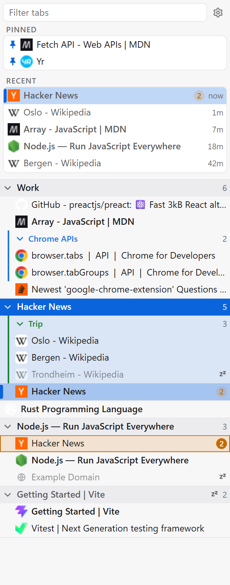
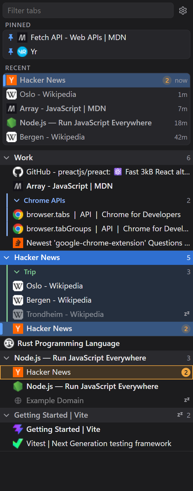
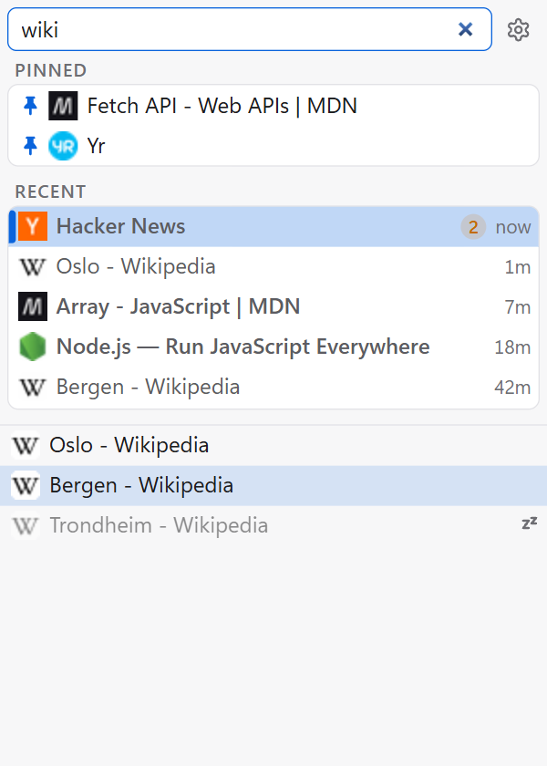
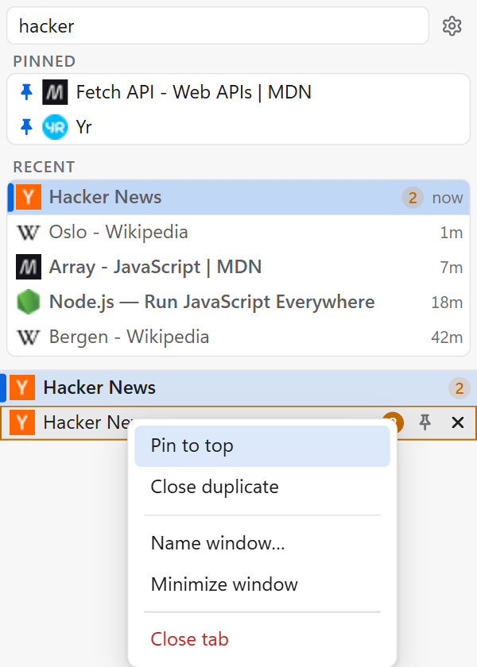
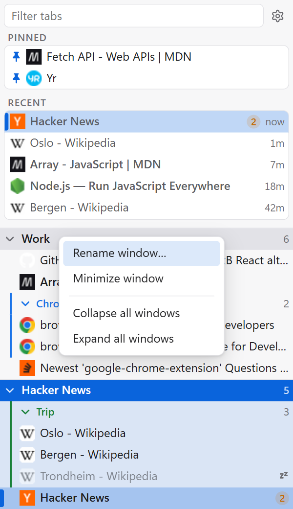
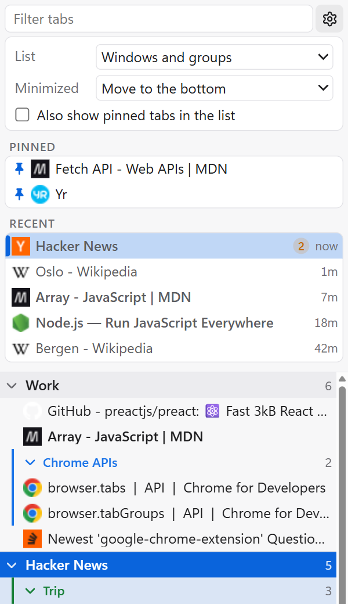
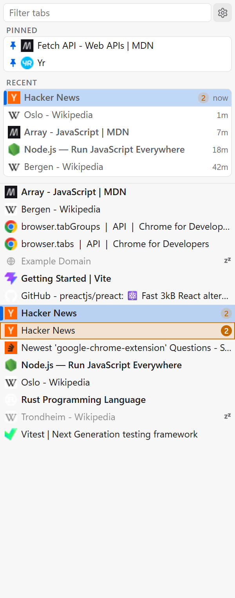
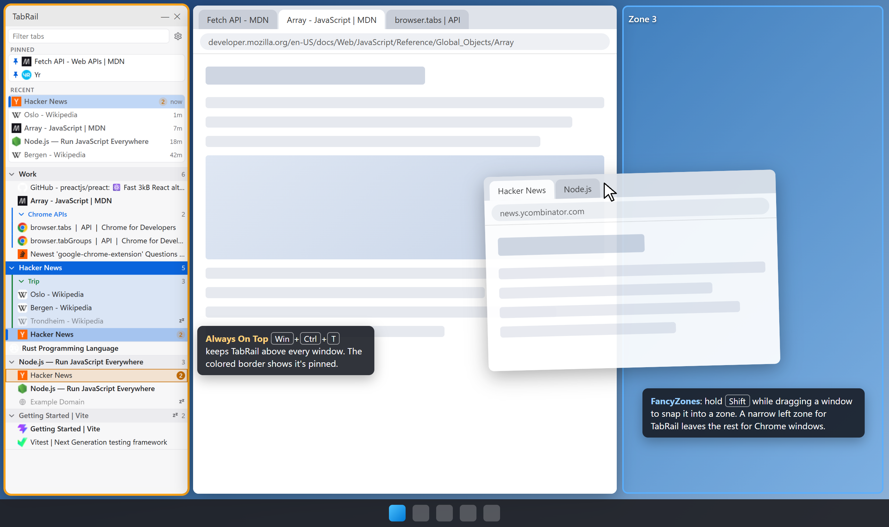

# TabRail

**Every Chrome window and tab in one always-visible sidebar.** TabRail is a Chrome extension for
people who keep dozens of windows and hundreds of tabs open. It lists them all in a compact tree,
keeps your recent and pinned tabs at the top, and gets you to any tab in a couple of keystrokes,
from anywhere in Windows.

<p align="center">
  
  &nbsp;&nbsp;
  
</p>

- **Private by design.** TabRail only reads your own tabs. Permissions are limited to `tabs`,
  `tabGroups`, `storage` and `favicon`; there are no host permissions, no content scripts, no
  network calls and no analytics.
- **Light and dark** follow the Windows theme.

---

## The fast path: shortcut → type → Enter

1. Press **Ctrl+Shift+1** anywhere in Windows, even when Chrome isn't the active app. The sidebar
   comes to the front (or opens) with the cursor in the filter box.
2. Type a few letters of the tab's title or URL.
3. Press **Enter**. The tab is activated and its window comes to the front.

Press **Esc** to clear the filter, and **Esc** again to jump back to the Chrome window you came from.

<p align="center">
  
</p>

### Filtering

- Case-insensitive and token-based: every word you type must match the title or the URL, in any
  order. `wiki oslo` and `oslo wiki` find the same tab; `github.com/preact` matches by URL.
- While a filter is active the list becomes a flat ranked list: best match first, then the most
  recently used.
- Sleeping tabs are included (dimmed, with a `zz` glyph), so you can find tabs Chrome has unloaded.

### Keyboard reference

| Key                       | Where                 | Action                                                     |
| ------------------------- | --------------------- | ---------------------------------------------------------- |
| **Ctrl+Shift+1**          | Anywhere in Windows   | Open or focus the sidebar and put the cursor in the filter |
| **↑ / ↓**                 | Filter                | Move the selection through the results                     |
| **Enter**                 | Filter                | Activate the selected tab and bring its window forward     |
| **Esc**                   | Filter                | Clear the filter                                           |
| **Esc** (again)           | Empty filter          | Return focus to the last Chrome window                     |
| **Shift+F10** / Menu key  | Filter                | Open the right-click menu for the selected result          |
| **↑ / ↓**, **Enter**, Esc | Right-click menu      | Move between items, choose, close                          |

> The shortcut is a Chrome _global_ command. You can change it, and check that its scope is
> **Global**, at `chrome://extensions/shortcuts`. Global shortcuts are limited to
> Ctrl+Shift+0…9.

---

## What you see

### Windows, groups and tabs

- **One-tab windows are a single row**; windows with more tabs get a compact header (the active
  tab's title or your own name for the window, plus a tab count) with indented tabs underneath.
- **Tab groups** appear as a collapsible sub-level with their Chrome color.
- The **focused window** is tinted, each window's active tab is **bold**, and the tab you're on
  right now also gets an accent bar.
- **Sleeping** tabs are dimmed with a `zz` glyph; a window that is minimized or fully asleep gets a
  dimmed header. Playing or muted tabs show a speaker glyph.
- The list is **stable**: windows stay in creation order and tabs in tab-strip order, so things
  don't jump around while you look for them. Only the highlight moves.
- Collapse a window or group with its chevron; collapse state is remembered.

### Pinned and Recent

- **Pinned** holds tabs you pin with the pin button that appears when you hover a row (or from the
  right-click menu). Click the leading pin to unpin. Pinned tabs are hidden from the main list by
  default. Pins survive closing their window and restarting Chrome: they come back when a tab with
  the same URL is open again. Closing the tab itself unpins it.
- **Recent** has a fixed number of slots showing the tabs you used most recently across all
  windows, with how long ago. The current tab is at the top marked _now_. The strip never changes
  height, so the list below it doesn't shift.

### Duplicates

Tabs whose URL is open more than once (ignoring `#fragments`) get a **count badge**. The duplicates
of the current tab, or of the selected filter result, are outlined so you can spot them across
windows; right-click → **Close duplicate(s)** closes the others and keeps this one.

---

## Mouse

- **Click** a tab to activate it and bring its window to the front.
- **Click the current tab again** to minimize its window, like clicking a taskbar button.
- **Click a window header** to bring that window forward; click the **chevron** to collapse it.
- **Middle-click** a tab to close it. A close button also appears on hover.
- **Right-click** a tab or a window header for more actions.

<p align="center">
  
  &nbsp;&nbsp;
  
</p>

| Menu          | Items                                                                                              |
| ------------- | -------------------------------------------------------------------------------------------------- |
| Tab           | Pin to top / Unpin · Close duplicate(s) · Name window… · Minimize / Restore window · Close tab      |
| Window header | Name / Rename window… · Minimize / Restore window · Collapse all windows · Expand all windows       |

**Window names** exist only in the sidebar (Chrome doesn't expose its own window names to
extensions). A named window shows its name in the header instead of the active tab's title, and the
name is re-attached after a browser restart by matching the window's tabs.

---

## Settings

Click the **gear** next to the filter.

<p align="center">
  
  &nbsp;&nbsp;
  
</p>

| Setting                              | Options                                                                                     |
| ------------------------------------ | ------------------------------------------------------------------------------------------- |
| **List**                             | _Windows and groups_ (the tree), or a _flat list_ of every tab with no headers or groups     |
| **Sort** (flat list only)            | Window and tab order, or by name (natural, case-insensitive)                                |
| **Minimized**                        | Keep minimized windows in place, move them to the bottom, or hide them                      |
| **Also show pinned tabs in the list** | Off by default: pinned tabs only appear in the Pinned section                              |

---

## Tip: keep it docked with PowerToys

On Windows, two [Microsoft PowerToys](https://learn.microsoft.com/windows/powertoys/) utilities
turn the TabRail window into a proper sidebar:

- **Always On Top**: click the TabRail window and press **Win+Ctrl+T**. It stays above every other
  window, with a colored border to show it's pinned. Press the shortcut again to release it.
- **FancyZones**: create a layout with a narrow zone along one edge for TabRail (about 260–340 px)
  and one or more zones for your Chrome windows. Hold **Shift** while dragging a window to snap it
  into a zone, or use **Win+Arrow** keys once FancyZones overrides Windows Snap. Your browser
  windows then fill the space next to the sidebar instead of sliding underneath it.

<p align="center">
  
</p>

_Illustration only: a mock desktop, not a real screenshot._ Phase B (see [Roadmap](#roadmap)) will
do this natively as a Windows AppBar.

---

## Install (unpacked)

TabRail isn't on the Chrome Web Store. Build it and load it unpacked:

```sh
cd extension
pnpm install
pnpm build
```

1. Open `chrome://extensions` and turn on **Developer mode**.
2. Click **Load unpacked** and pick `extension/dist`.
3. Click the TabRail toolbar button (or press **Ctrl+Shift+1**) to open the sidebar.

The sidebar is a Chrome popup window. It opens at the left edge of the screen, 300 px wide and full
height, and remembers where you put it. To keep it in view, see the PowerToys tip below.

After pulling changes, run `pnpm build` again and click the reload button on the extension's card;
the version number on the card shows which build is loaded.

### Development

| Command     | What it does                                                          |
| ----------- | --------------------------------------------------------------------- |
| `pnpm dev`  | Watch build into `extension/dist`                                     |
| `pnpm build`| Type-check, then build the extension and the standalone UI            |
| `pnpm test` | Vitest unit tests (tab model, Recent, filter ranking, layout rules)   |
| `pnpm lint` | TypeScript, ESLint and Prettier checks                                |

The UI can also run in a normal browser tab against a mock data source: run
`pnpm preview:standalone` and open the page with `?mock`.

---

## Roadmap

- **Phase B:** a Windows desktop host (WPF + WebView2) that docks the same sidebar as a real
  **AppBar**, so maximized windows make room for it instead of sliding underneath. It talks to the
  extension over Native Messaging; nothing changes in the UI.
- More ideas are collected in [docs/WISHLIST.md](docs/WISHLIST.md). Design rules and the internal
  protocol are in [CLAUDE.md](CLAUDE.md).

---

## License

[MIT](LICENSE). The settings icon comes from [Lucide](https://lucide.dev) (ISC); see
[THIRD_PARTY_NOTICES.md](THIRD_PARTY_NOTICES.md).
